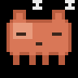
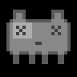

# 🦀 clawdgotchi

**Firmware propio y autónomo para el GeekMagic SmallTV Ultra** que convierte el
cubo en un tamagotchi de la mascota de Claude: muestra tus cuotas de uso de
Claude Code (ventana de 5 h y semanal) con una mascota que cambia de humor, más
un modo reloj. Se autentica **él solo** contra la API de Anthropic — sin PC ni
demonio de por medio.

> **Descargo:** proyecto no oficial, sin afiliación con GeekMagic ni Anthropic.





## Qué hace

- **Tamagotchi de cuotas.** La mascota (Clawd) tiene **6 humores** según la
  **peor** de tus dos cuotas *usadas* (5 h y semanal), calculado en `moodFor()`:
  contenta (<50 %), inquieta (50-74 %), agobiada (75-89 %), pánico (≥90 %),
  dormida (cuota agotada, con cuenta atrás hasta el reset) y desconectada (sin
  datos/WiFi). Debajo, dos barras coloreadas por nivel con la etiqueta y el
  countdown: `5h (2h 57m)` … `19%`.
- **Reloj** NTP con hora grande sans-serif (FreeSans Bold), zona horaria
  configurable y **desplazamiento antiquemado** (la hora orbita unos píxeles
  cada minuto).
- **Rotación** automática entre tamagotchi y reloj, con **transición de fundido**
  (fade) de duración ajustable.
- **Autónomo de verdad.** El cubo obtiene el token de Claude **en el propio
  dispositivo** mediante login OAuth (PKCE): abres Claude en el móvil, pegas un
  código una vez, y el cubo guarda access + refresh token y se renueva para
  siempre. Sin ordenador, sin CLI, sin `setup-token`.
- **Interfaz web** (tarjetas, tema oscuro coral) para configurarlo todo:
  pantalla, brillo, rotación, fade, zona horaria, servidor NTP, contraseña,
  login de Claude y actualización OTA.
- **A prueba de brickeo.** Tras 3 crashes seguidos arranca en modo seguro (solo
  web UI + OTA) y se auto-recupera a los 30 s. La puerta OTA (`/update`) está
  siempre disponible.

## Hardware

GeekMagic **SmallTV Ultra**: ESP8266 (ESP-12F, 4 MB flash), pantalla IPS 1.54"
240×240 ST7789 sobre SPI. Pines en `src/board.h` y `platformio.ini`.

> ⚠️ Hay varios modelos con la misma carcasa y chips distintos (SmallTV ESP8266,
> **Ultra**, Pro ESP32, clones ESP32-C2). Este firmware es **solo para el Ultra**;
> flashear el modelo equivocado puede brickearlo. Confirma el modelo en
> `http://<ip>/v.json` del firmware de fábrica (debe decir `SmallTV-Ultra`).

## Instalación

El hueco OTA del firmware de fábrica es pequeño, así que la primera vez se usa un
*loader* en dos pasos (sin abrir la caja). Detalle completo en
[`docs/instalacion.md`](docs/instalacion.md).

1. **Backup** del firmware stock (red de seguridad) — del
   [repo oficial](https://github.com/GeekMagicClock/smalltv-ultra).
2. **Loader**: sube `smalltv-mod-loader.bin` (de las
   [releases de smalltv-mod](https://github.com/giovi321/smalltv-mod/releases))
   en `http://<ip>/update`. El cubo abre un AP `SmallTV-Loader`.
3. **Clawdgotchi**: únete al AP y sube `.pio/build/ultra/firmware.bin` en
   `http://192.168.4.1/update`.

A partir de ahí, todas las actualizaciones van por OTA (`tools/flash-ota.sh`).
Recuperación por UART como plan B (ver `docs/instalacion.md`).

## Configuración

Al primer arranque el cubo abre un portal WiFi cautivo (`Clawdgotchi-Setup`).
Después, en `http://clawdgotchi.local/` (o por IP), **usuario `admin`**:

1. Pon una **contraseña** (obligatoria para iniciar sesión con Claude).
2. **Inicia sesión con Claude** (recomendado, sin ordenador): pulsa «Abrir login
   de Claude» desde el móvil, inicia sesión, copia el código que te da Claude y
   pégalo. El cubo hace el canje OAuth y se renueva solo para siempre.
   - *Alternativa manual:* pega un token de `claude setup-token`.
3. Ajusta pantalla, brillo, rotación, fade, zona horaria y servidor NTP a gusto.

## Desarrollo

Requiere [PlatformIO](https://platformio.org/).

```sh
# Compilar (las credenciales WiFi van SOLO por build flags, nunca en el repo)
PLATFORMIO_BUILD_FLAGS="-DCLAWD_WIFI_SSID='\"MiRed\"' -DCLAWD_WIFI_PASS='\"MiClave\"'" \
  pio run -e ultra

# Tests de la lógica pura (parseo de cuotas, humor, countdowns, config)
pio test -e native        # 9 tests

# Regenerar los sprites de la mascota (Pillow)
python3 tools/make_sprites.py

# Flashear por OTA a un cubo ya instalado
CLAWD_WEB_AUTH=admin:clave tools/flash-ota.sh clawdgotchi.local
```

La lógica testeable en host vive en `lib/core/` (C++ puro, sin Arduino); el
resto en `src/`. Ver [`AGENTS.md`](AGENTS.md) para el mapa de módulos, las
convenciones y las lecciones de hardware.

## Arquitectura (resumen)

| Módulo | Responsabilidad |
|---|---|
| `lib/core/quota` | Parseo de cabeceras de rate-limit, humor de la mascota, countdowns (testeable) |
| `lib/core/config_codec` | Config y tokens ↔ JSON (testeable) |
| `src/main.cpp` | Orquestador: estados de arranque, planificador de poll, rotación, modo seguro |
| `src/claude_client` | Poll de cuota y refresh de token por TLS (BearSSL, CA pineada) |
| `src/oauth_login.h` | Login OAuth PKCE en el dispositivo |
| `src/webui.h` | Interfaz web + rutas de configuración |
| `src/wifi_portal.h` | Portal cautivo de primer arranque |
| `src/display / screen_tama / screen_clock` | Pantalla ST7789 y las dos vistas |
| `src/sprites.h` | Sprites de la mascota (generados por `tools/make_sprites.py`) |
| `src/safemode.h` | Contador de crashes anti-brickeo |

## Seguridad

- La web UI lleva contraseña (usuario `admin`); los **tokens nunca se muestran**
  ni se exportan por la interfaz.
- TLS con raíces de CA **pineadas** (`src/certs.h`), nunca `setInsecure`.
- Las credenciales WiFi solo entran por build flags; **no hay secretos en el repo**.

## Limitaciones honestas

- El flujo OAuth y las cabeceras de rate-limit de Claude Code **no son API
  pública documentada** de Anthropic; funcionan hoy pero podrían cambiar.
- El ESP8266 va justo de RAM: el handshake TLS usa un buffer de 8 KB (ver
  `AGENTS.md`); sin MFLN no cabía más.

## Licencia y agradecimientos

[MIT](LICENSE). Como referencia de hardware y de los endpoints se usaron
[smalltv-mod](https://github.com/giovi321/smalltv-mod) y
[clawdmeter-daemon](https://github.com/giovi321/clawdmeter-daemon) (WTFPL).
